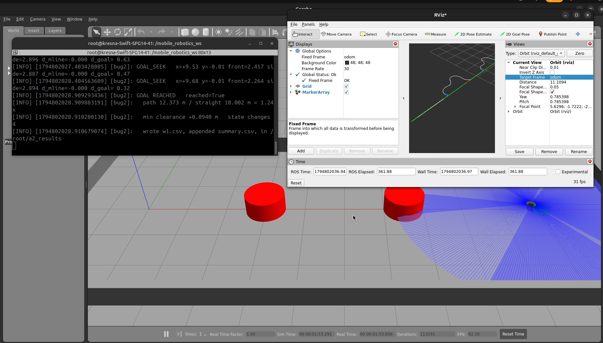
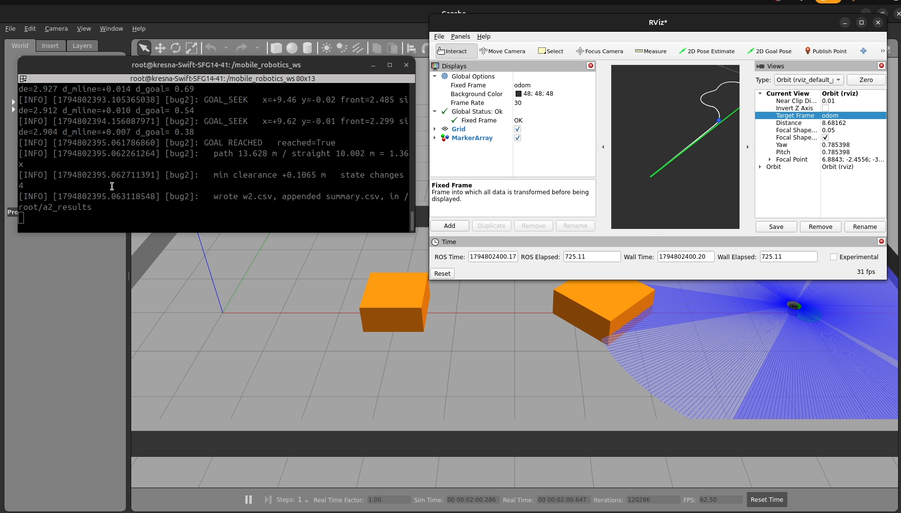
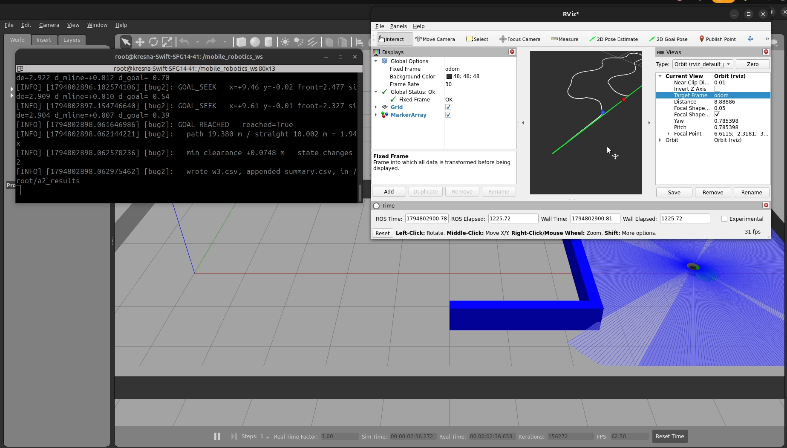

# Assignment 2: Reactive Path Planning (`a2_worlds` - Bug 2)

- **Name:** Anak Agung Ngurah Agung Kresna Ananta
- **NRP:** 5024241085
- **Course:** Mobile Robotics — Computer Engineering, ITS
- **Start Offset ($Y_0$):** `-0.20` (`0.10 * (5024241085 % 5) - 0.20`)

## Run Configurations

| Run Name | World | `Y0` | `MODE` | `RUN_NAME` | `HAND` | `DELTA` |
| :--- | :--- | :---: | :---: | :---: | :---: | :---: |
| `w1` | `bug_1_circles` | `-0.20` | `'bug2'` | `'w1'` | `+1` | `0.25` |
| `w2` | `bug_2_boxes` | `-0.20` | `'bug2'` | `'w2'` | `+1` | `0.25` |
| `w3` | `bug_3_concave` | `-0.20` | `'bug2'` | `'w3'` | `+1` | `0.25` |
| `w1_naive` | `bug_1_circles` | `-0.20` | `'bug2'` | `'w1_naive'` | `+1` | `-1e6` |
| `w3_right` | `bug_3_concave` | `-0.20` | `'bug2'` | `'w3_right'` | `-1` | `0.25` |

## Experimental Results (`results/summary.csv`)

| Run | Mode | Reached | Time (s) | Path (m) | Ratio | Min Clearance (m) | State Changes | Final $d_{\text{goal}}$ (m) |
| :--- | :---: | :---: | :---: | :---: | :---: | :---: | :---: | :---: |
| `w1` | `bug2` | `True` | 91.2 | 12.373 | 1.237 | 0.0940 | 4 | 0.247 |
| `w2` | `bug2` | `True` | 101.0 | 13.628 | 1.363 | 0.1065 | 4 | 0.240 |
| `w3` | `bug2` | `True` | 138.1 | 19.380 | 1.938 | 0.0748 | 2 | 0.248 |
| `w1_naive` | `bug2` | `False` | 240.0 | 2.122 | 0.212 | 0.2711 | 4509 | 7.880 |
| `w3_right` | `bug2` | `True` | 139.1 | 19.582 | 1.958 | 0.0611 | 2 | 0.244 |

## RViz2 Trajectory Screenshots

### World 1 (`w1` — `bug_1_circles`)

### World 2 (`w2` — `bug_2_boxes`)

### World 3 (`w3` — `bug_3_concave`)

## Demo Videos (YouTube)

- **`w1` (`bug_1_circles`, `HAND = +1`, `DELTA = 0.25`):** https://youtu.be/your-w1-video-id
- **`w2` (`bug_2_boxes`, `HAND = +1`, `DELTA = 0.25`):** https://youtu.be/your-w2-video-id
- **`w3` (`bug_3_concave`, `HAND = +1`, `DELTA = 0.25`):** https://youtu.be/your-w3-video-id
- **`w1_naive` (`bug_1_circles`, `HAND = +1`, `DELTA = -1e6`):** https://youtu.be/your-w1-naive-video-id
- **`w3_right` (`bug_3_concave`, `HAND = -1`, `DELTA = 0.25`):** https://youtu.be/your-w3-right-video-id