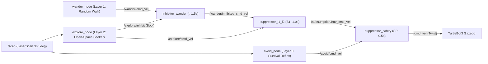
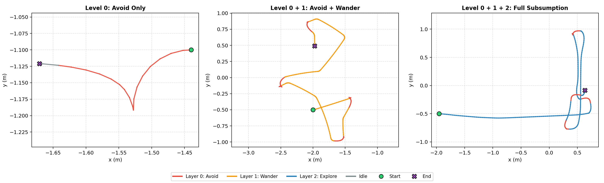

# ROS 2 Subsumption Architecture on TurtleBot3 (Gazebo)

- **Name:** Anak Agung Ngurah Agung Kresna Ananta
- **NRP:** 5024241085
- **Course:** Mobile Robotics — Computer Engineering, ITS
- **Reference Paper:** Minglong Li et al., *"Subsumption Model Implemented on ROS for Mobile Robots"* (National University of Defense Technology, IEEE 2016)

---

## 1. Multi-Node Architecture & Coordination Mechanism

Each behavior module is formalized as an independent **ROS-based Finite State Machine (FSM)**, while inter-layer coordination is handled by reusable timestamp-based **`inhibitor_node`** and **`suppressor_node`** templates communicating asynchronously via ROS 2 Publish/Subscribe:



### Module Summary

| Layer / Role | Node Name | Executable | Internal FSM & Responsibility |
| :--- | :--- | :--- | :--- |
| **Layer 0** *(Safety)* | `avoid_node` | `avoid_node` | `IDLE_SAFE`, `RUNAWAY` (virtual repulsive force `feelforce`), `EMERGENCY_COLLIDE` (`halt` + reverse/turn). Emits a single `Twist(0, 0)` on exit to `IDLE_SAFE` and stays silent when safe. |
| **Layer 1** *(Wander)* | `wander_node` | `wander_node` | `SAMPLE_HEADING`, `TURN_RANDOM`, `CRUISE_FORWARD` — periodic timer-driven stochastic wandering without obstacle awareness. |
| **Layer 2** *(Explore)* | `explore_node` | `explore_node` | `MONITOR_IDLE`, `LOOK_SCAN`, `PLAN_PATH`, `HEAD_OPEN_SPACE` — 360° LiDAR sector scoring (`inf` mapped to `range_max`) to seek open corridors. |
| **Inhibitor** | `inhibitor_wander` | `inhibitor_node` | Blocks `/wander/cmd_vel` for `timespan = 1.5 s` whenever `/explore/inhibit` fires. |
| **Suppressor 1** | `suppressor_l1_l2` | `suppressor_node` | Replaces inhibited wander commands with `/explore/cmd_vel` for `timespan = 1.0 s`. |
| **Suppressor 2** | `suppressor_safety` | `suppressor_node` | Guarantees `/avoid/cmd_vel` overrides `/cmd_vel` for `timespan = 0.5 s` whenever an obstacle enters the danger zone. |

---

## 2. Build & Sync to Docker Container (`ros2_humble`)

All ROS 2 commands run inside the `ros2_humble` Docker container (`osrf/ros:humble-desktop-full`). To sync the package to `/home/kresna/mobile_robotics_ws/src/turtlebot3_subsumption` and build selectively without affecting previous packages (`a2_worlds`):

```bash
./scripts/sync_and_build.sh
```

---

## 3. Running the Incremental Simulation Demo

### Terminal 1 (Host -> Container): Launch Gazebo GUI (`turtlebot3_world`)

```bash
# On Ubuntu 24.04 host:
xhost +local:docker
docker start ros2_humble
docker exec -it -e DISPLAY=$DISPLAY ros2_humble bash

# Inside ros2_humble container:
source /opt/ros/humble/setup.bash
source /usr/share/gazebo/setup.sh
export TURTLEBOT3_MODEL=burger
export GAZEBO_MODEL_DATABASE_URI=""
export GAZEBO_MODEL_PATH="/opt/ros/humble/share/turtlebot3_gazebo/models:${GAZEBO_MODEL_PATH}"

ros2 launch turtlebot3_gazebo turtlebot3_world.launch.py
```

### Terminal 2 (Container): Launch Subsumption Levels Incrementally

```bash
docker exec -it ros2_humble bash
source /opt/ros/humble/setup.bash
source /mobile_robotics_ws/install/setup.bash

# Level 0 — Avoid Contact only
ros2 launch turtlebot3_subsumption level0_avoid.launch.py

# Level 0 + 1 — Avoid + Wander + Safety Suppressor
ros2 launch turtlebot3_subsumption level1_wander.launch.py

# Level 0 + 1 + 2 — Full 3-Layer Subsumption
ros2 launch turtlebot3_subsumption level2_explore.launch.py
```

*(Optional CSV trajectory logging — disabled by default to keep `rqt_graph` clean:)*

```bash
ros2 launch turtlebot3_subsumption level2_explore.launch.py \
  record_trajectory:=true output_csv:=/mobile_robotics_ws/level2.csv
```

### Terminal 3 (Container): RViz2 Visualization (Live `/scan` + `/odom` Trail)

```bash
docker exec -it -e DISPLAY=$DISPLAY -e ROS_DOMAIN_ID=85 ros2_humble bash -c \
  "source /opt/ros/humble/setup.bash && source /mobile_robotics_ws/install/setup.bash && ros2 launch turtlebot3_subsumption rviz.launch.py"
```

### Terminal 4 (Container): Node Graph Verification (`rqt_graph`)

```bash
docker exec -it -e DISPLAY=$DISPLAY -e ROS_DOMAIN_ID=85 ros2_humble bash -c \
  "source /opt/ros/humble/setup.bash && rqt_graph"
```

---

## 4. Experimental Results (`turtlebot3_world`, `burger`)

| Test Scenario | Duration (s) | Path Length (m) | BBox Area ($\text{m}^2$) | Min Clearance (m) | L0 Avoid (%) | L1 Wander (%) | L2 Explore (%) | Idle (%) |
| :--- | :---: | :---: | :---: | :---: | :---: | :---: | :---: | :---: |
| **Level 0 (Open Space)** | 12.6 | `0.00` | `0.00` | `0.503` | 0.0% | 0.0% | 0.0% | 100.0% |
| **Level 0 (Near Pillar)** | 15.6 | `0.31` | `0.02` | `0.201` | 22.5% | 0.0% | 0.0% | 77.5% |
| **Level 0 + 1 (Wander)** | 56.0 | `5.42` | `2.11` | `0.279` | 23.8% | 74.5% | 0.0% | 1.8% |
| **Level 0 + 1 + 2 (Full)** | 55.3 | `7.34` | `4.69` | `0.260` | 21.2% | 0.0% | 78.4% | 0.4% |

### 2D Trajectory Comparison (Level 0 vs Level 0+1 vs Level 0+1+2)



### Key Observations
- **Level 0:** Remains 100% stationary (`0.00 m`) in open space. When placed close to a pillar (`0.201 m`), `avoid_node` immediately triggers `EMERGENCY_COLLIDE` -> `RUNAWAY`, escapes to safe clearance (`>= 0.37 m`), and halts cleanly.
- **Level 0 + 1:** Random wandering covers `5.42 m` (`2.11 m²`) with `suppressor_safety` activating cleanly (`23.8%`) to maintain zero collisions (`min_clearance = 0.279 m > 0.105 m` robot radius).
- **Level 0 + 1 + 2:** Adding `explore_node`, `inhibitor_wander`, and `suppressor_l1_l2` produces purposeful corridor-following behavior, increasing total distance by **+35%** (`7.34 m`) and explored bounding-box area by **+122%** (`4.69 m²`, > 2.2× wider than Level 1) while maintaining collision-free clearance (`0.260 m`).

---

## 5. Demo Video (YouTube)

> *(Add your YouTube demo link here once uploaded)*
