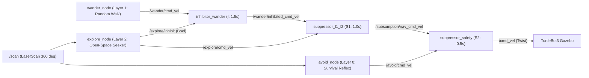

# ROS 2 Subsumption Architecture on TurtleBot3 (Gazebo)

Implementasi modular **Subsumption Architecture** 3-layer (**Avoid**, **Wander**, **Explore**) dengan template node **Inhibitor** dan **Suppressor** berbasis ROS 2 Humble pada simulasi TurtleBot3 Gazebo, mengadaptasi paper:

> *Minglong Li et al., "Subsumption Model Implemented on ROS for Mobile Robots" (National University of Defense Technology, IEEE 2016).*

---

## 1. Arsitektur Multi-Node & Mekanisme Koordinasi

Setiap perilaku (*behavior module*) diformalisasikan sebagai **ROS-based Finite State Machine (FSM)** independen, sedangkan koordinasi antar-layer menggunakan node template reusable `inhibitor_node` dan `suppressor_node` (2 *callback* asinkron dengan perbandingan `timestamp` terhadap parameter `timespan`):



### Ringkasan Modul

| Node / Layer | Executable | Peran & FSM Internal |
| :--- | :--- | :--- |
| **Layer 0** (`avoid_node`) | `avoid_node` | `IDLE_SAFE`, `RUNAWAY` (gaya repulsif virtual `feelforce`), `EMERGENCY_COLLIDE` (`halt` + mundur/putar). Mengirim 1× `Twist(0, 0)` saat kembali ke `IDLE_SAFE` lalu diam agar tidak menekan layer lain. |
| **Layer 1** (`wander_node`) | `wander_node` | `SAMPLE_HEADING`, `TURN_RANDOM`, `CRUISE_FORWARD` — gerak acak periodik berbasis timer internal. |
| **Layer 2** (`explore_node`) | `explore_node` | `MONITOR_IDLE`, `LOOK_SCAN`, `PLAN_PATH`, `HEAD_OPEN_SPACE` — pemindaian sektor 360° LiDAR (`inf` dipetakan ke `range_max`) untuk mencari koridor/ruang terbuka terdalam. |
| **Inhibitor** (`inhibitor_wander`) | `inhibitor_node` | Memblokir `/wander/cmd_vel` selama `timespan` (`1.5 s`) setiap kali `/explore/inhibit` aktif. |
| **Suppressor 1** (`suppressor_l1_l2`) | `suppressor_node` | Menimpa keluaran `wander` yang terhambat dengan `/explore/cmd_vel` selama `timespan` (`1.0 s`). |
| **Suppressor 2** (`suppressor_safety`) | `suppressor_node` | Menjamin `/avoid/cmd_vel` selalu mengambil alih `/cmd_vel` selama `timespan` (`0.5 s`) saat rintangan mendekat. |

---

## 2. Build & Sinkronisasi ke Container `ros2_humble`

Seluruh perintah ROS 2 dijalankan di dalam container Docker `ros2_humble` (host Ubuntu 24.04). Untuk menyinkronkan kode dari folder ini ke `/home/kresna/mobile_robotics_ws/src/turtlebot3_subsumption` dan melakukan build selektif (tanpa mengganggu `a2_worlds`):

```bash
./scripts/sync_and_build.sh
```

---

## 3. Panduan Menjalankan Simulasi Demo (Gazebo + `rqt_graph`)

### Terminal 1 (Host -> Container): Jalankan Gazebo GUI (`turtlebot3_world`)

```bash
# Di host Ubuntu 24.04:
xhost +local:docker
docker start ros2_humble
docker exec -it ros2_humble bash

# Di dalam container ros2_humble:
source /opt/ros/humble/setup.bash
source /usr/share/gazebo/setup.sh
export TURTLEBOT3_MODEL=burger
export GAZEBO_MODEL_DATABASE_URI=""
export GAZEBO_MODEL_PATH="/opt/ros/humble/share/turtlebot3_gazebo/models:${GAZEBO_MODEL_PATH}"

ros2 launch turtlebot3_gazebo turtlebot3_world.launch.py
```

*(Opsional untuk lingkungan lorong/ruangan multi-kamar, ganti baris terakhir dengan `ros2 launch turtlebot3_gazebo turtlebot3_house.launch.py`.)*

### Terminal 2 (Container): Jalankan Arsitektur Subsumption Secara Inkremental

```bash
docker exec -it ros2_humble bash
source /opt/ros/humble/setup.bash
source /mobile_robotics_ws/install/setup.bash

# Demo 1 — Level 0 (Avoid Only: diam di ruang kosong, menghindar saat didekati rintangan)
ros2 launch turtlebot3_subsumption level0_avoid.launch.py

# Demo 2 — Level 0 + 1 (Avoid + Wander: berkeliling acak tanpa menabrak)
ros2 launch turtlebot3_subsumption level1_wander.launch.py

# Demo 3 — Level 0 + 1 + 2 (Full Subsumption: aktif mencari lorong/ruang terbuka)
ros2 launch turtlebot3_subsumption level2_explore.launch.py
```

Untuk merekam lintasan CSV (opsional, default `false` agar `rqt_graph` bersih):

```bash
ros2 launch turtlebot3_subsumption level2_explore.launch.py \
  record_trajectory:=true output_csv:=/mobile_robotics_ws/level2.csv
```

### Terminal 3 (Container): Visualisasi RViz2 (Live LiDAR `/scan` + Jejak `/odom`)

```bash
docker exec -it -e DISPLAY=$DISPLAY -e ROS_DOMAIN_ID=85 ros2_humble bash -c \
  "source /opt/ros/humble/setup.bash && source /mobile_robotics_ws/install/setup.bash && ros2 launch turtlebot3_subsumption rviz.launch.py"
```

### Terminal 4 (Container): Verifikasi Graf Node (`rqt_graph`)

```bash
docker exec -it -e DISPLAY=$DISPLAY -e ROS_DOMAIN_ID=85 ros2_humble bash -c "source /opt/ros/humble/setup.bash && rqt_graph"
```

*(Pada toolbar `rqt_graph`, pilih **Nodes/Topics (all)** dan hilangkan centang `Debug` agar 6 node subsumption serta aliran topiknya terlihat sangat jelas untuk laporan.)*

---

## 4. Hasil Pengujian Simulasi Gazebo (`turtlebot3_world`, `burger`)

Pengujian terverifikasi dijalankan menggunakan Gazebo (`turtlebot3_world`, radius robot `0.105 m`, jarak antar-pilar `0.80 m`):

| Skenario Uji | Durasi (s) | Panjang Lintasan (m) | Luas Cakupan BBox ($\text{m}^2$) | Jarak Minimum Rintangan (m) | Layer 0 Avoid (%) | Layer 1 Wander (%) | Layer 2 Explore (%) | Idle (%) |
| :--- | :---: | :---: | :---: | :---: | :---: | :---: | :---: | :---: |
| **Level 0 (Ruang Terbuka)** | 12.6 | `0.00` | `0.00` | `0.503` | 0.0% | 0.0% | 0.0% | 100.0% |
| **Level 0 (Dekat Pilar)** | 15.6 | `0.31` | `0.02` | `0.201` | 22.5% | 0.0% | 0.0% | 77.5% |
| **Level 0 + 1 (Wander)** | 56.0 | `5.42` | `2.11` | `0.279` | 23.8% | 74.5% | 0.0% | 1.8% |
| **Level 0 + 1 + 2 (Full)** | 55.3 | `7.34` | `4.69` | `0.260` | 21.2% | 0.0% | 78.4% | 0.4% |

### Perbandingan Lintasan 2D (Level 0 vs Level 0+1 vs Level 0+1+2)


### Analisis Singkat
* **Level 0:** Robot tetap diam total (`0.00 m`) saat berada di area terbuka. Saat ditempatkan tepat di samping pilar (`d_min = 0.201 m`), `avoid_node` langsung masuk ke state `EMERGENCY_COLLIDE` -> `RUNAWAY`, bergerak menjauh hingga aman (`>= 0.37 m`), lalu mengirim 1 perintah henti dan kembali `IDLE_SAFE`.
* **Level 0 + 1:** Penambahan `wander_node` dan `suppressor_safety` membuat robot menjelajah acak sejauh `5.42 m` (`2.11 m²`) tanpa pernah menabrak rintangan (`min_clearance = 0.279 m > 0.105 m`).
* **Level 0 + 1 + 2:** Penambahan `explore_node`, `inhibitor_wander`, dan `suppressor_l1_l2` menghasilkan lintasan yang jauh lebih terarah melintasi lorong antar-pilar: jarak tempuh meningkat **+35%** (`7.34 m`) dan cakupan area meningkat **+122%** (`4.69 m²`, > 2.2× lebih luas dibanding Level 1) dalam durasi yang sama, sambil tetap dilindungi refleks keselamatan `avoid_node` (`21.2%`, `min_clearance = 0.260 m`).
